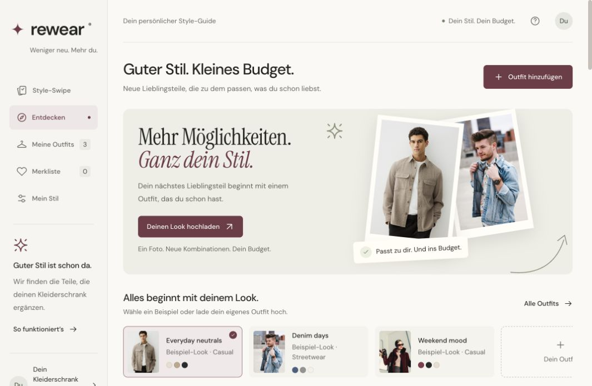
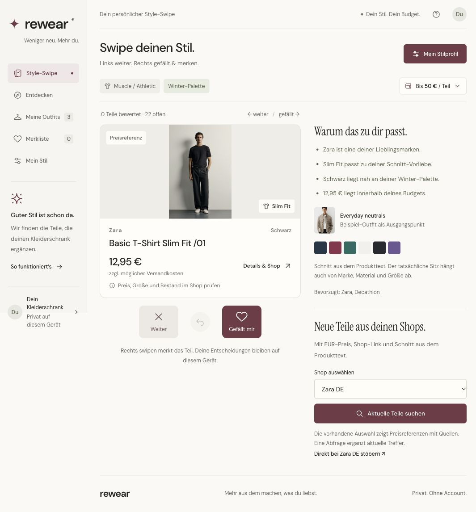
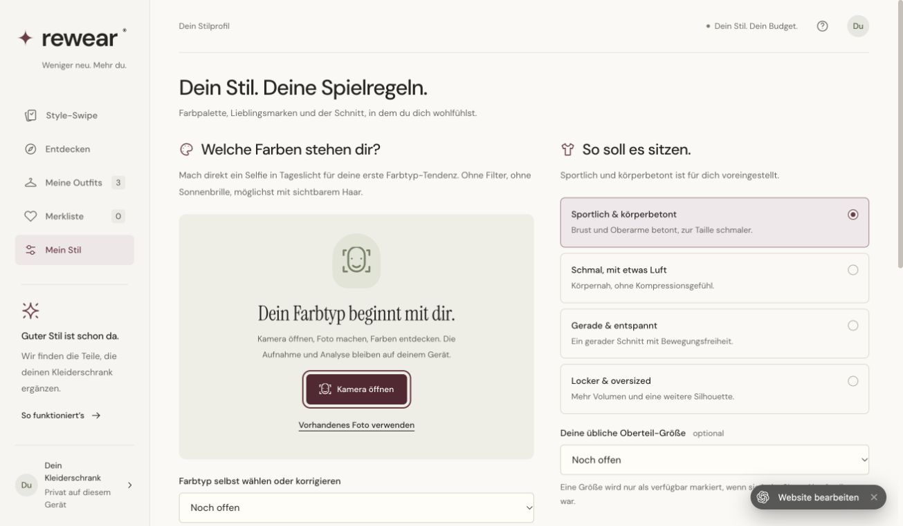

# REWEAR

**Dein Kleiderschrank als Ausgangspunkt. Neue Lieblingsteile im Budget.**

Eine Web-App, die günstige Kleidung passend zu vorhandenen Outfits, Lieblingsmarken, Farbpalette und bevorzugtem Schnitt empfiehlt. Mit Style-Swipe, direkter Selfie-Kamera und einer optionalen lokalen Apple-Fotos-Analyse auf dem Mac.



## Das bekommst du

| Funktion | Was sie macht |
| --- | --- |
| **Style-Swipe** | Links weiter, rechts merken. Likes und Dislikes beeinflussen die nächsten Vorschläge. Mit Rückgängig und Tastaturbedienung. |
| **Direkte Selfie-Kamera** | Kamera öffnen, Foto aufnehmen und lokal eine erste Farbtyp-Tendenz ermitteln. Kein vorheriger Datei-Upload nötig. |
| **Deine Marken und Schnitte** | Zara, Decathlon oder eigene Favoriten; Muscle/Athletic, Slim, Regular oder Relaxed. |
| **Budget und Shop-Links** | Artikel nach Budget, Kategorie und Schnitt filtern; Preise, Quelle und Abrufzeit nachvollziehen; direkt zum Händler wechseln. |
| **Outfit-Vergleich** | Ein vorhandenes Outfit mit einem neuen Teil vergleichen und die Farb- und Stilgründe ansehen. |
| **Lokaler Kleiderschrank** | Auf macOS exportierte Apple-Fotos-Bilder analysieren, Kleidungs-Ausschnitte gruppieren und Zuordnungen prüfen, zusammenführen oder trennen. |

### Swipen statt endlos suchen

Preis, Schnitt und die Gründe für eine Empfehlung stehen direkt am Kleidungsstück. Das Budget gilt pro Artikel, ohne Versand. Referenzpreise sind sichtbar als solche gekennzeichnet.



### Ein Selfie direkt in der App

Unter **Mein Stil → Kamera öffnen → Foto aufnehmen & analysieren** startet die lokale Farbanalyse. Die Aufnahme bleibt vorübergehend im Browser-Arbeitsspeicher. Gespeichert werden die Farbwerte und die gewählte Palette. Beim Schließen oder Tabwechsel wird die Kamera beendet; ein Mikrofon wird nicht angefordert.



Die Screenshots zeigen die Beispieloberfläche mit öffentlichen Produkt- und Inspirationsbildern. Im Repository sind keine privaten Nutzerfotos oder persönlichen Foto-Analysen enthalten.

## Lokal starten

Voraussetzung: **Node.js 22 oder neuer**. Für den normalen Web-Modus ist kein API-Schlüssel nötig.

```sh
git clone https://github.com/eliaspfeffer/rewear.git
cd rewear
npm ci
npm run setup:vision
npm run dev
```

Öffne **http://127.0.0.1:4173**. Die einmalige Modell-Einrichtung lädt das offizielle MediaPipe-Modell und kopiert die Laufzeit aus dem installierten npm-Paket. Die Kamera benötigt eine Browserfreigabe und funktioniert auf localhost oder über HTTPS. Die eigentliche Fotoanalyse läuft auf dem Gerät.

### Optional: Apple-Fotos-Kleiderschrank auf macOS

Benötigt macOS und die Xcode Command Line Tools (`swiftc`). Nach der Einrichtung:

```sh
npm run local
```

Öffne **http://127.0.0.1:4174/#outfits**. Alternativ startet `REWEAR lokal.command` denselben lokalen Begleiter.

1. Wähle in Apple Fotos deine eigene Personensammlung aus.
2. Exportiere die gewünschten Bilder als JPEG nach `~/Library/Application Support/REWEAR/Apple-Fotos`, möglichst ohne Standort- und Beschreibungsmetadaten. Die Originale bleiben in Fotos.
3. Starte die Analyse im lokalen Kleiderschrank. Apple Vision erkennt Körperpositionen, erstellt Kleidungs-Ausschnitte und sammelt Farb- und Bildmerkmale.
4. Prüfe unklare Ausschnitte und Bilder mit mehreren Personen. Gleiche oder ähnliche Kleidungsstücke lassen sich zusammenführen oder trennen.

Das ist ein lokaler Export-Snapshot. Neue Fotos müssen erneut exportiert werden; die App liest nicht automatisch die laufende Apple-Fotos-Datenbank. Die vom Nutzer gewählte Personensammlung ersetzt keine sichere eigene Gesichtserkennung.

## Datenschutz und Grenzen

- **Bilder bleiben lokal.** Outfit-Fotos, Einstellungen und Likes liegen im Browser. Selfies werden nicht dauerhaft gespeichert. Foto-Arbeitskopien, Ausschnitte und Merkmale des macOS-Begleiters liegen ausschließlich im lokalen REWEAR-Datenordner.
- **Keine Foto-Uploads an KI-Dienste.** MediaPipe und Apple Vision rechnen auf dem Gerät. Externe Anfragen laden das Modell oder lesen öffentliche Shop-Daten; keine Gesichtsaufnahmen oder Hautfarbstichproben werden an Händler geschickt.
- **Farbtyp ist eine Tendenz.** Licht, Make-up, Haarfarbe und Kamera beeinflussen das Ergebnis. Farbstichproben und Palette sind editierbar; eine kalibrierte Farbanalyse wird nicht ersetzt.
- **Kein perfektes Kleidungs-Inventar.** Ähnliche Shirts und dasselbe Shirt in verschiedenen Posen können verwechselt werden. Unklare Fälle bleiben zur Prüfung. Stoff, Ausschnitt und Körpermaße werden nicht zuverlässig aus Fotos bestimmt.
- **Shop-Daten können blockiert sein.** Unterstützt werden deutsche Produktseiten von Zara, Decathlon, TeeShoppen, Gymshark, H&M und UNIQLO. Die App zeigt Fehler bei blockierten Abrufen und erfindet keine aktuellen Preise oder Bestände. Verbindlich ist das Händlerangebot; Bestellungen erfolgen im Shop.
- **Kein gemeinsamer Cloud-Speicher.** Browserdaten sind je Gerät und Ursprung getrennt. Die gehostete Oberfläche kann den privaten lokalen Kleiderschrank nicht auslesen.

## Entwicklung

```sh
npm run check   # Syntaxprüfung
npm test        # 25 Tests für Matching, Preise, lokale Gruppierung und Kamera-Lebenszyklus
npm run build  # Worker-Bundle mit eingebetteter Weboberfläche
```

HTML, CSS und native JavaScript-Module; MediaPipe für lokale Gesichts-Landmarks; Apple Vision über Swift für den optionalen macOS-Begleiter; Node.js für lokale Server; esbuild für das Worker-Bundle. Kein Frontend-Framework und keine bezahlte KI-API erforderlich.

| Verzeichnis | Inhalt |
| --- | --- |
| `public/` | Weboberfläche, Farbtyp- und Empfehlungslogik, Beispielkatalog |
| `local/` | Native Apple-Vision-Analyse und lokales Inventar |
| `worker/` | Händler-Abfragen und Worker-Einstieg |
| `scripts/` | Dev-Server, macOS-Begleiter, Modell-Einrichtung und Build |
| `tests/` | Automatisierte Funktions- und Sicherheitstests |
| `docs/screenshots/` | Echte Screenshots der Beispieloberfläche |

Das Worker-Bundle entsteht unter `dist/server/index.js`. Die enthaltene `.openai/hosting.json` ist absichtlich leer: Es werden keine private Site-ID oder Zugangsdaten mitgeliefert. Für eine eigene Sites-Veröffentlichung muss ein eigenes Projekt registriert und dessen ID eingetragen werden.

Siehe [QA.md](QA.md) für Prüfstand und Grenzen sowie [THIRD_PARTY_NOTICES.md](THIRD_PARTY_NOTICES.md) für Bild-, Schrift- und Modellquellen.
